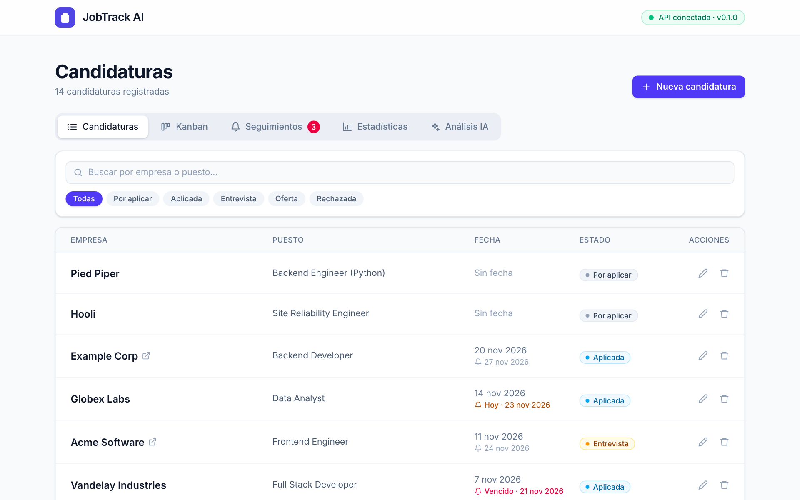
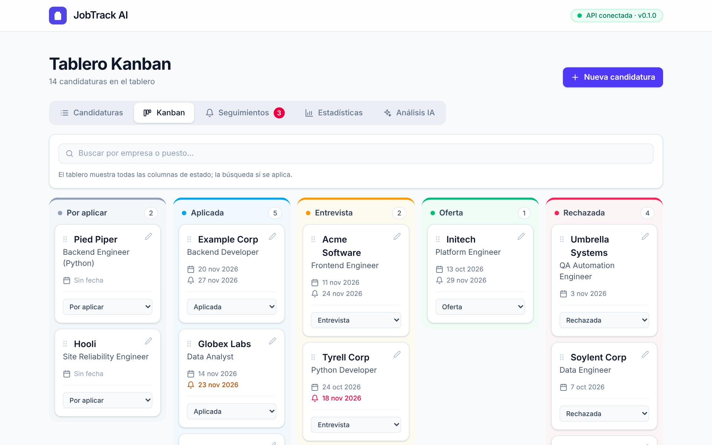
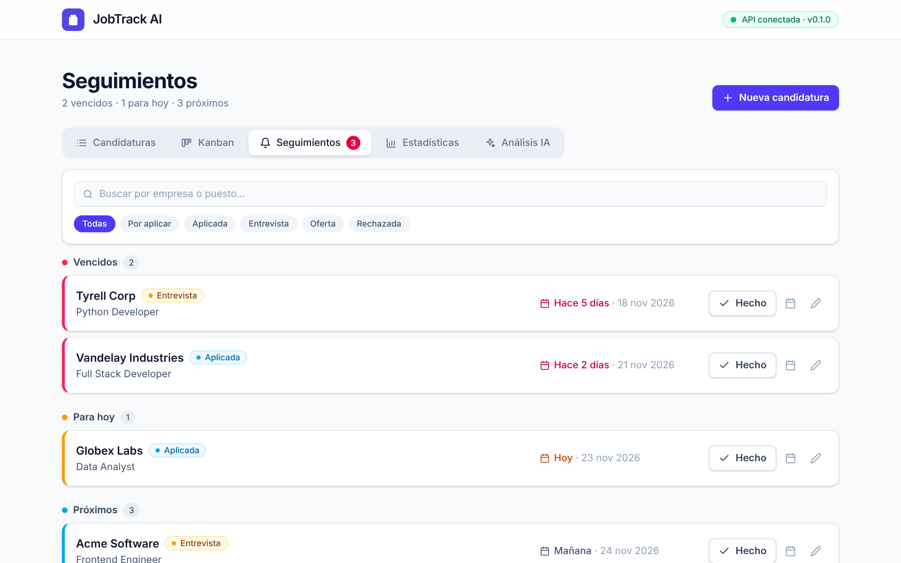
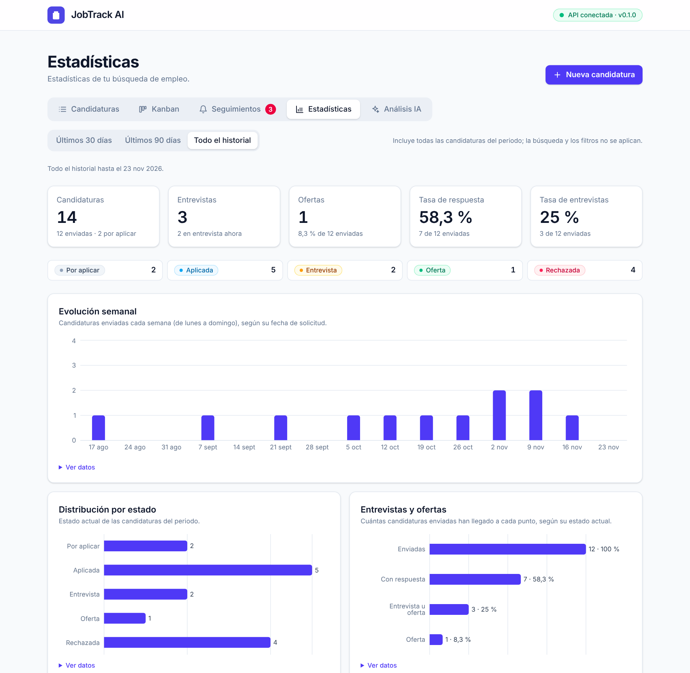
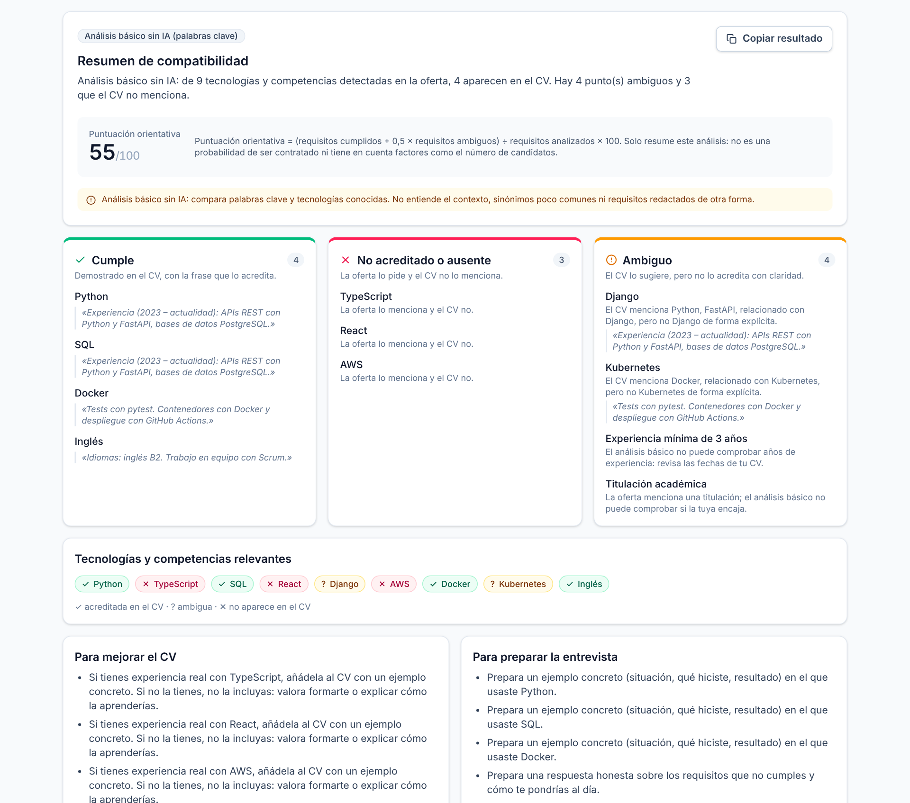
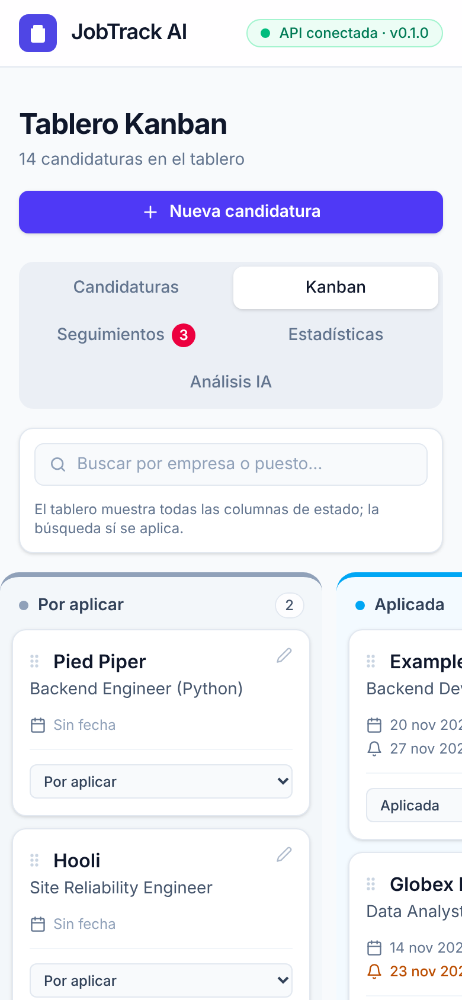
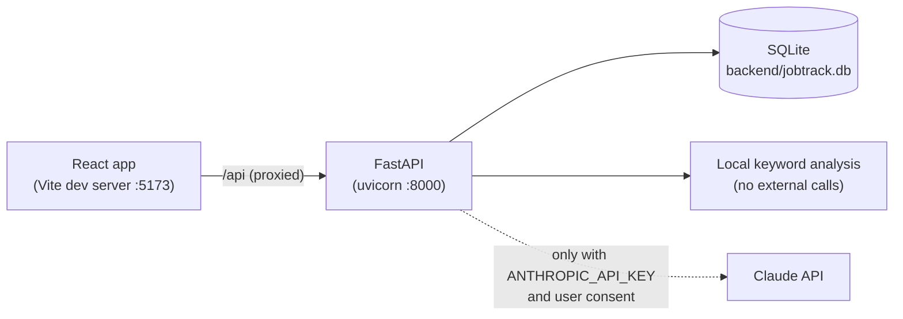

# JobTrack AI

[](https://github.com/vaazquezz/jobtrack-ai/actions/workflows/ci.yml)

**A personal job-search tracker.** Keep every application in one place, move it through a
Kanban board, never miss a follow-up, see how your search is going, and compare your CV
with a job offer — with a basic analysis that works offline, or with Claude if you add an
API key.

It is a full-stack portfolio project (React + TypeScript and FastAPI + SQLite) built in
small, tested phases, each one a pull request with CI. The interface is in Spanish; the
code and documentation are in English.



> All screenshots use the fictional demo data (`python -m app.seed`) and fictional
> texts. No personal data, real CVs or API keys appear anywhere in the repository.

## Contents

- [Features](#features)
- [Screenshots](#screenshots)
- [Tech stack](#tech-stack)
- [Architecture](#architecture)
- [Run it on your computer](#run-it-on-your-computer)
- [Tests and quality checks](#tests-and-quality-checks)
- [How the job offer analysis works](#how-the-job-offer-analysis-works)
- [Known limitations](#known-limitations)
- [Technical decisions and learnings](#technical-decisions-and-learnings)
- [Security and privacy](#security-and-privacy)
- [Future improvements](#future-improvements)
- [Development workflow](#development-workflow)

## Features

- **Applications** — create, edit and delete applications (company, position, URL,
  applied date, status, notes, follow-up date). The form validates the same rules as the
  API and still shows any error the API returns. Deleting asks for confirmation.
- **Search and filters** — search by company or position (ignoring case and accents) and
  filter by status; results come from the API as you type.
- **Kanban board** — one column per status. Drag a card to change its status, or use the
  *Mover a* selector / keyboard (space, ←/→, space). Moves are shown at once and rolled
  back with a *Reintentar* alert if the server fails.
- **Follow-ups** — applications with a follow-up date grouped into overdue, today and
  upcoming, with a pending counter on the tab. Mark one as done (it is noted in the
  application), reschedule it with quick options or remove it.
- **Statistics** — KPIs, counts per status, and charts of weekly activity, status
  distribution and interviews/offers for the last 30 days, 90 days or all time. Every
  chart has an accessible *Ver datos* table.
- **Job offer analysis** — paste a CV and an offer to see what the CV demonstrates (with
  the quote that proves it), what is missing or ambiguous, the relevant skills,
  recommendations for the CV and the interview, and an orientative score.
- **Everything stays in sync** — any change in one tab refreshes the others; the selected
  tab is kept in the URL (`#kanban`, `#seguimientos`, `#estadisticas`, `#analisis`).
- **Responsive and accessible** — cards on phones and a table on larger screens, a board
  that scrolls column by column, labelled controls, dialogs that close with Escape, and
  loading, empty and error states with *Reintentar*.

## Screenshots

| Kanban board | Follow-ups |
| --- | --- |
|  |  |

| Statistics | Job offer analysis (basic mode) |
| --- | --- |
|  |  |

<p align="center">
  
</p>

## Tech stack

| Layer    | Technology |
| -------- | ---------- |
| Frontend | React 19, TypeScript, Vite, Tailwind CSS 4, dnd-kit (drag and drop), Recharts (charts) |
| Backend  | Python 3.11+, FastAPI, SQLModel, Pydantic Settings, official Anthropic SDK |
| Database | SQLite |
| Quality  | pytest, ruff, Vitest, Testing Library, oxlint, GitHub Actions |

## Architecture



- The **frontend** is a single page with five tabs. A small typed `fetch` client talks to
  the API, and custom hooks (`useApplications`, `useBoard`, `useFollowUps`, `useStats`)
  load each view. A shared version counter, bumped after every change, keeps all tabs in
  sync. The statistics tab (and Recharts) is lazy-loaded.
- The **backend** exposes a REST API under `/api`, split into routers (applications,
  follow-ups, stats, analysis). Business rules — validation, follow-up grouping,
  statistics, the analysis score — live in the backend, so the UI only displays them.
- The **analysis** goes through a small `AIProvider` interface with two implementations:
  a local keyword analyser and an Anthropic provider. A service on top verifies the
  result and computes the score, whichever provider ran.

```
jobtrack-ai/
├── backend/
│   ├── app/
│   │   ├── main.py, config.py, database.py, models.py, filters.py
│   │   ├── routers/      # applications, follow_ups, stats, analysis
│   │   ├── analysis/     # provider interface, local analyser, Anthropic provider, service
│   │   └── seed.py       # optional fictional demo data
│   ├── tests/            # pytest suite (isolated SQLite, fake AI providers)
│   └── pyproject.toml    # dependencies, ruff and pytest config
├── frontend/
│   └── src/
│       ├── api/          # typed fetch client for each endpoint
│       ├── components/   # page, views (list, Kanban, follow-ups, stats, analysis), dialogs
│       ├── hooks/        # data loading for each view
│       ├── lib/          # validation, formatting, Kanban/stats/follow-up helpers
│       └── types/        # shared TypeScript types
├── docs/
│   ├── API.md            # full API reference and metric definitions
│   └── screenshots/
├── .github/workflows/    # CI pipeline
└── .env.example          # environment variables template (no secrets)
```

The full endpoint list, request fields, error codes and metric definitions are in
**[docs/API.md](docs/API.md)**. With the backend running, interactive docs are at
<http://localhost:8000/docs>.

## Run it on your computer

The app runs locally with two processes: the backend (API + database) and the frontend
(the web page). Nothing is deployed anywhere.

### Prerequisites

- **Python 3.11 or newer** — check with `python3 --version` (on Windows: `py --version`).
- **Node.js 22.22+ or 24.15+** — check with `node --version`. (The app itself runs on
  20.19+, but the test tooling needs these versions.)
- **Git**, to clone the repository.

```bash
git clone https://github.com/vaazquezz/jobtrack-ai.git
cd jobtrack-ai
```

### 1. Backend (first terminal)

macOS / Linux:

```bash
cd backend
python3 -m venv .venv
source .venv/bin/activate
pip install -e ".[dev]"
cp ../.env.example .env        # optional: the defaults work without it
uvicorn app.main:app --reload
```

Windows (PowerShell):

```powershell
cd backend
py -m venv .venv
.venv\Scripts\Activate.ps1
pip install -e ".[dev]"
copy ..\.env.example .env      # optional: the defaults work without it
uvicorn app.main:app --reload
```

The API runs at <http://localhost:8000> (docs at <http://localhost:8000/docs>). The
database is created automatically in `backend/jobtrack.db`, which is git-ignored.

### 2. Frontend (second terminal)

```bash
cd frontend
npm install
npm run dev
```

Open <http://localhost:5173>. The dev server forwards `/api` requests to the backend, and
the badge in the header shows whether the API is reachable.

### 3. Optional: load the demo data

To try the app with realistic content, load 14 fictional applications (every status,
overdue/today/upcoming follow-ups, a few months of history). From `backend/` with the
virtual environment active:

```bash
python -m app.seed
```

It **never overwrites anything**: if the database already has applications, it adds
nothing. Dates are relative to today, so it always looks current. To start again from
scratch, stop the backend and delete `backend/jobtrack.db`.

### Configuration

All settings are optional and go in `backend/.env` (see [`.env.example`](.env.example));
restart the backend after changing them.

| Variable | Default | Purpose |
| --- | --- | --- |
| `DATABASE_URL` | `sqlite:///./jobtrack.db` | SQLite file location |
| `CORS_ORIGINS` | `http://localhost:5173` | Origins allowed to call the API |
| `ANTHROPIC_API_KEY` | *(empty)* | Enables AI analysis; empty = basic analysis only |
| `ANTHROPIC_MODEL` | `claude-opus-5-5` | Claude model used for AI analysis |
| `AI_TIMEOUT_SECONDS` | `60` | Time to wait for the AI provider |
| `AI_MAX_RETRIES` | `2` | Retries on transient technical failures only |

## Tests and quality checks

```bash
# Backend (from backend/, virtual environment active)
ruff check . && ruff format --check .
pytest

# Frontend (from frontend/)
npm run lint
npm test          # Vitest + Testing Library (jsdom)
npm run build     # type-check (tsc -b) and production build
```

The same checks run in GitHub Actions on every pull request and on pushes to `main`. The backend tests
use an isolated SQLite database and fake AI providers; the frontend tests mock the API and
freeze the date, so results do not depend on the day they run. No test calls a real (paid)
API.

## How the job offer analysis works

In the *Análisis IA* tab you paste a CV and a job offer (30–20,000 characters each) and
choose a mode:

**Basic analysis (no AI, always available).** The backend looks for about 50 known
technologies and competencies (with aliases, ignoring case and accents) in the offer, and
checks whether each one appears in the CV. Nothing leaves your computer. It is fast and
free, but it does not understand context, unusual synonyms or requirements phrased
differently, and it always marks years of experience and degrees as ambiguous — the UI
says so next to every result.

**AI analysis (optional).** If `ANTHROPIC_API_KEY` is set in `backend/.env`, the AI mode
becomes available. Before anything is sent, the UI asks you to confirm that the full texts
will go to an external provider (the backend also rejects AI requests without that
consent). The backend sends both texts to Claude through the official Anthropic SDK, with
instructions to use only what the CV says and to treat the texts as data. The answer is
constrained to a JSON schema and validated again with Pydantic. Each AI analysis is a paid
API call billed to your key.

To enable it: create a key in the Anthropic Console, add `ANTHROPIC_API_KEY=...` to
`backend/.env` (never to Git — the file is ignored) and restart the backend.

**In both modes:**

- Each requirement is classified as **met**, **missing** or **ambiguous**. A *met*
  requirement must quote text that really appears in the CV; the backend checks the quote
  and downgrades it to *ambiguous* if it is not there, so invented experience is never
  reported as demonstrated.
- The **orientative score** = (met + 0.5 × ambiguous) ÷ requirements analysed × 100, computed
  by the backend, not by the model. It summarises this comparison only — it is not a
  probability of being hired.
- The CV and the offer are processed in memory: they are not stored in the database,
  logged or saved in the browser.
- Errors (timeouts, rate limits, invalid key, unexpected responses) are shown as clear
  messages. If the model declines a request for safety reasons, the user is told so; the
  request is not retried with another model, and the app never switches to the basic mode
  silently.

More detail, including status codes, is in [docs/API.md](docs/API.md#ai-analysis).

## Known limitations

- **Single user, local only.** There is no authentication; it is designed to run on your
  own computer, not on a shared server.
- **No status history.** Only the current status of each application is stored, so
  statistics describe where applications are today. For example, an application rejected
  after an interview counts as a response but not as an interview, and interviews cannot
  be placed on a timeline. See the [metric definitions](docs/API.md#statistics).
- **No database migrations.** The schema is created on startup; a future change to the
  models would need a migration tool (see [future improvements](#future-improvements)).
- **Basic analysis is keyword matching**, with the limits described above. The AI mode
  needs your own API key and costs money per analysis.
- **CV as plain text.** You paste the text; PDF or Word files are not read.
- **No notifications.** Follow-up reminders live in the app (counter and tab); there are
  no emails or push notifications.
- The interface is in Spanish only.

## Technical decisions and learnings

- **Business rules in the backend.** Validation, follow-up grouping, statistics and the
  analysis score are computed by the API and covered by pytest. The frontend mirrors the
  form validation for instant feedback but still shows the API's errors.
- **No schema changes after phase 1.** Follow-ups reuse `follow_up_date` and append a line
  to the notes when completed, instead of adding tables. Without a migration tool, this
  keeps existing `jobtrack.db` files working.
- **Honest metrics.** Rates are `null` (shown as "—") when there is nothing to divide by,
  and undated applications are counted separately instead of being given an invented
  date. The limits of the data are documented rather than hidden.
- **Don't trust the model blindly.** Structured output plus Pydantic validation, a check
  that every quoted piece of evidence is really in the CV, and a score computed from the
  lists rather than asked for. Safety refusals are shown to the user and never sent to
  another model; only transient technical failures are retried.
- **Provider interface.** The `AIProvider` protocol made it easy to ship a useful local
  mode first and to test the AI path with fake clients, without paid calls.
- **Optimistic Kanban with rollback.** Moves feel instant, but a failed request puts the
  card back and offers a retry. The status filter is deliberately ignored on the board so
  moved cards do not vanish.
- **Accessibility from the start.** Drag and drop has a selector and keyboard alternative,
  charts have data tables, and tests query elements by role and label.
- **Small bundle where it matters.** Recharts is lazy-loaded with the statistics tab.
- **Deterministic tests.** Frontend tests freeze `Date`; backend endpoints accept a
  `today` parameter. Key tests were checked by temporarily breaking the code they cover
  to make sure they fail.
- **Small phases, one PR each.** Every phase was reviewed through a pull request with CI,
  which kept `main` working at all times.

## Security and privacy

- No secrets in the repository: local settings live in `backend/.env`, which is
  git-ignored; `.env.example` contains no values for secrets.
- The Anthropic key is read only by the backend as a secret value (not printed in logs or
  settings dumps) and never reaches the browser; `/api/analysis/config` only says whether
  AI is available.
- The SQLite database (`*.db`) is git-ignored; CVs and offers are never stored.
- External AI calls need an explicit confirmation in the UI and `consent_external: true`
  in the API.
- Tests use fictional texts and fake providers only. The demo data uses fictional
  companies and `example.com` links.
- CORS only allows the local frontend origin by default.

## Future improvements

Ideas, not planned work:

- Database migrations with Alembic.
- Reading CVs from PDF or Word files.
- A status-change history, for real timelines of responses and interviews.
- Authentication, if it ever becomes multi-user.
- Docker Compose to start both services with one command.
- Export to CSV.
- Choose and add a license.

## Development workflow

- `main` is the stable branch and only receives changes through reviewed pull requests
  with green CI.
- Each phase is developed on its own branch:

| Phase | Pull request |
| --- | --- |
| 0. Project skeleton, health endpoint and CI | [#1](https://github.com/vaazquezz/jobtrack-ai/pull/1) |
| 1. Applications REST API (CRUD) | [#2](https://github.com/vaazquezz/jobtrack-ai/pull/2) |
| 2. Applications UI (list and form) | [#3](https://github.com/vaazquezz/jobtrack-ai/pull/3) |
| 3. Search and filters | [#4](https://github.com/vaazquezz/jobtrack-ai/pull/4) |
| 4. Follow-up reminders | [#5](https://github.com/vaazquezz/jobtrack-ai/pull/5) |
| 5. Kanban board | [#6](https://github.com/vaazquezz/jobtrack-ai/pull/6) |
| 6. Statistics dashboard | [#7](https://github.com/vaazquezz/jobtrack-ai/pull/7) |
| 7. Job offer analysis (basic and AI) | [#8](https://github.com/vaazquezz/jobtrack-ai/pull/8) |
| 8. Portfolio polish: docs, screenshots, demo data | this branch |
